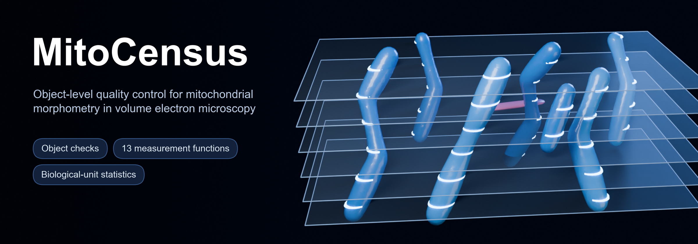
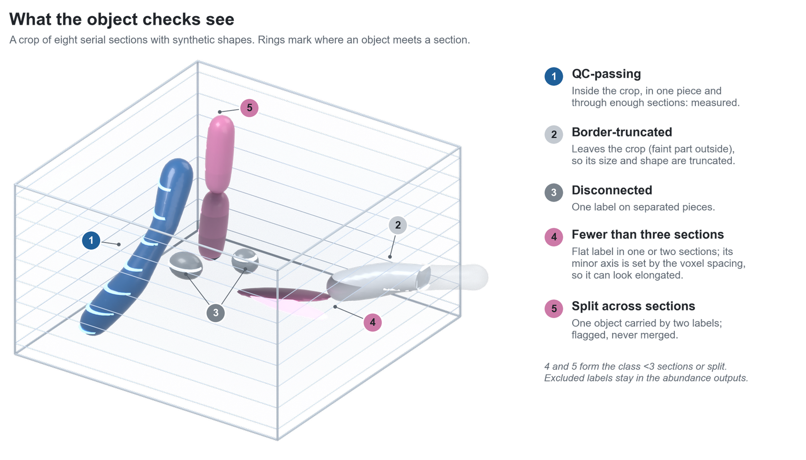
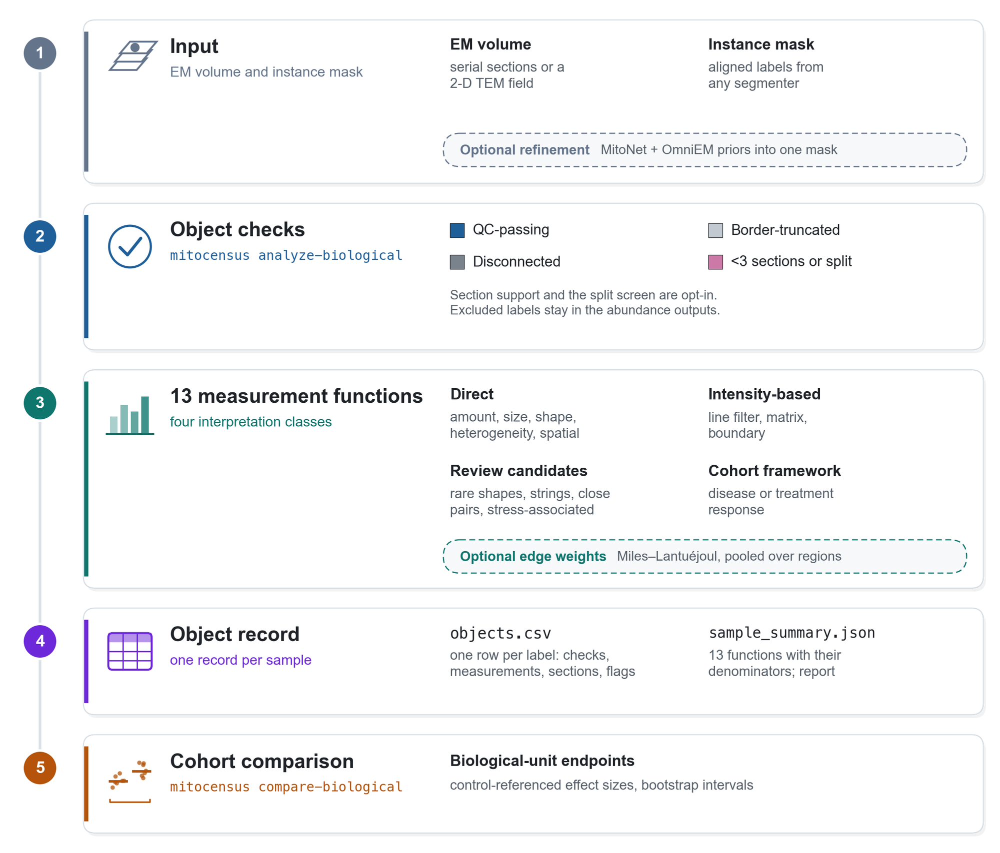

<p align="center">
  
</p>

<p align="center">
  <a href="LICENSE"></a>
  
  
  <a href="https://doi.org/10.5281/zenodo.23390544"></a>
  <a href="CITATION.cff"></a>
</p>

**MitoCensus turns a volume electron microscopy stack and any aligned mitochondrial instance mask into an
object-linked measurement record.** Every label is traced to its source sections and checked before it is measured.
Excluded labels stay visible, edge bias from a finite crop can be corrected, and cohort statistics are computed by
biological unit rather than by object. A visual record shows every check and measurement on the object, the sections
and the voxels it came from.

## Why check objects

Voxel-overlap scores such as Dice do not show whether a segmentation delivers whole mitochondria. Labels confined to
one or two sections, labels cut by the crop border and one mitochondrion split across sections can all score well, and
they change size and shape statistics. MitoCensus checks every label before it enters whole-object morphometry.

<p align="center">
  <picture>
    <source media="(prefers-color-scheme: dark)" srcset="docs/images/mitocensus_object_checks_dark.png">
    
  </picture>
</p>

## How it works

<p align="center">
  <picture>
    <source media="(prefers-color-scheme: dark)" srcset="docs/images/mitocensus_workflow_dark.png">
    
  </picture>
</p>

| Command | What it does |
|---|---|
| `mitocensus analyze-biological` | Checks and measures every label of one sample; writes the object record and its visual record |
| `mitocensus visual-record` | Rewrites the visual record of a finished analysis from its image and labels |
| `mitocensus compare-biological` | Compares groups by biological unit from several analysed samples |
| `mitocensus infer-from-priors` | Optional refinement module that combines aligned MitoNet and OmniEM probabilities |

## What the evidence shows

Technical results on public volumes (MitoEM 2.0 and CellMap). Mitochondria, sections, crops and voxels are nested
technical observations; none of these results is a biological-replicate claim.

- **Voxel overlap does not certify objects.** On the held-out CellMap kidney crops, the refined masks had the highest
  pooled Dice (0.929, against 0.909 for OmniEM and 0.801 for MitoNet), yet MitoNet returned the most objects that
  matched an annotated mitochondrion among those passing the border and connectivity checks (46, against 38 and 24).
  About half of the refined, OmniEM and micro-SAM objects passing these checks spanned only one or two sections, and
  such labels made up 79–86% of the objects classified as elongated.
- **A section-extent check, not a volume threshold.** Requiring an extent of 90 nm across sections (three 30-nm
  sections) removed these labels and none of the matched objects. In expert annotations of eight MitoEM 2.0 volumes,
  the kidney and liver, it removed at most 0.8% of complete mitochondria in nine of ten sets (4.1% in one volume, all
  smaller than 0.001 µm³). A minimum volume of 0.005 µm³, which also cleaned the kidney outputs, removed 13% of the
  complete mitochondria of another volume, and 0.01 µm³ removed 35%.
- **What the checks do not fix.** Many objects that pass are multi-section fragments of a mitochondrion (61–74% in
  the small kidney crops); the checks remove thin labels but do not repair splits. The split screen flags likely
  splits for review.
- **Edge weights** (`--edge-correction-weights`) brought mean mitochondrial volume, pooled over crop positions, to
  within 6% of the whole-volume value for mitochondria that fit the crop, in the five development volumes with at
  least 100 whole objects. A single small crop holds too few whole objects for a reliable estimate in most tissues.
- **The optional refinement module** had the highest semantic Dice of three models in seven of eight development
  volumes (used for model selection). It met the primary endpoint of the held-out kidney set but not that of the
  three-dataset set, and neither set met all prespecified criteria. Validate it on the acquisition of interest before
  use.

## Install

```bash
conda env create -f environment.yml
conda activate mitocensus
python -m pip install '.[biology]'       # measurement, reports and the visual record
python -m pip install '.[refinement]'    # only for the optional refinement module (PyTorch)
```

`environment.yml` pins the tested library versions. With other versions, intensity-derived measurements can differ
by less than 0.08%, or by less than 1e-7 for values near zero; see [docs/REPRODUCIBILITY.md](docs/REPRODUCIBILITY.md).

## Verify

```bash
python scripts/verify_minimal_example.py       # expected: MINIMAL_EXAMPLE_PASS
python scripts/verify_biological_analysis.py   # expected: BIOLOGICAL_ANALYSIS_PASS
python -m pytest -q
```

The minimal example is synthetic: 3-D inputs, the selected refinement checkpoint, the reconstruction policy, the
expected outputs and their SHA-256 hashes. It runs on CPU and needs neither upstream segmenter. The 44 tests (134
parameterized subtests) use synthetic data only. `SHA256SUMS.txt` lists the SHA-256 checksum of every other file of the
release; `shasum -a 256 -c SHA256SUMS.txt` checks them.

## Quick start

Measure one sample. The instance mask can come from any segmenter; for 2-D TEM fields give `Y,X` spacing.

```bash
mitocensus analyze-biological \
  --raw sample_raw.tif \
  --instances sample_instances.tif \
  --spacing 30,16,16 \
  --sample-id specimen-01 \
  --group control \
  --output specimen-01_census \
  --edge-correction-weights
```

Since 0.4.0 the section-extent check (`--min-axial-extent-nm 90`) and the split screen as a review flag
(`--split-screen-min-iou 0.4 --split-screen-action flag`) are on by default for 3-D data; `none` turns either off, and
`--split-screen-action exclude --min-axial-extent-nm none --min-axial-sections 3` reproduces the 0.3.x "all checks".
Open `specimen-01_census/visual_record/index.html` to see what was measured and what was excluded.

Compare groups by biological unit, with one manifest row per analysed field or volume
([template](examples/biological/cohort_manifest_template.csv)):

```bash
mitocensus compare-biological \
  --manifest cohort.csv \
  --control-group control \
  --output cohort_response
```

## Outputs

| File | Contents |
|---|---|
| `objects.csv` | One row per label: measured features, the checks it passed or failed and candidate flags |
| `sample_summary.json` | The 13 function summaries with their denominators and claim boundaries |
| `contacts.csv` | Close mitochondrion pairs and junction-like review candidates |
| `manual_review_instances.tif` | Flagged object IDs only, aligned to the input |
| `biological_report.png` | A compact visual report |
| `visual_record/` | `index.html` with the check outcome, the labels excluded as too thin, QC-passing objects by shape class, possible splits and object pages (sections, surface, skeleton and the voxels behind the intensity features); `visual_record.json` records that the features recomputed from the displayed voxels equal the table |
| `analysis_manifest.json` | SHA-256 hashes of inputs and outputs |
| `group_response.csv` (cohort) | Control-referenced deltas, Hedges g and biological-unit bootstrap intervals |

Excluded labels remain in the abundance outputs, and every trait summary reports its denominator of QC-passing
objects. The full input, output and claim contract is in [docs/BIOLOGICAL_ANALYSIS.md](docs/BIOLOGICAL_ANALYSIS.md).

## Interpreting the outputs

- Shape classes describe static geometry. They do not measure fission or fusion events.
- Line-filter, matrix and boundary features are intensity-based and depend on the acquisition. Compare them only
  within a documented fixation, staining and imaging protocol.
- Rare shapes, mitochondria-on-a-string or nanotunnel-like geometry, close pairs and stress-associated patterns are
  review candidates. Inspect the raw serial sections before reporting them.
- The outputs are exploratory image phenotypes. They do not measure molecular activity, metabolic function, a
  cell-death mechanism or a clinical state.

## Optional refinement module

`infer-from-priors` combines aligned MitoNet and OmniEM foreground probabilities with five adjacent raw sections,
through a learned spatial gate and a bounded residual correction, and can rebuild 3-D instances from MitoNet panoptic
objects with the released reconstruction policy. Obtain and run the upstream tools separately under their own
licenses. All eight MitoEM 2.0 development volumes were used for model selection, and the reconstruction policy was
designed after development failures. Held-out predictions were sealed before the references were read, but the four
CellMap acquisitions are not demonstrated independent donors or biological replicates. See the
[quick start](docs/QUICKSTART.md), the [model card](docs/MODEL_CARD.md) and the
[DOME-ML checklist](docs/DOME_ML_CHECKLIST.md).

## Documentation

- [Quick start](docs/QUICKSTART.md): step-by-step use of the three commands
- [Object analysis](docs/BIOLOGICAL_ANALYSIS.md): inputs, outputs, object checks and the interpretation contract
- [Reproducibility](docs/REPRODUCIBILITY.md): tested environments and expected numerical differences
- [Model card](docs/MODEL_CARD.md) and [DOME-ML checklist](docs/DOME_ML_CHECKLIST.md): the optional refinement module
- [Release notes](RELEASE_NOTES.md)

## Citing MitoCensus

A manuscript describing MitoCensus is in preparation. Until it is published, cite the archived software:
[10.5281/zenodo.23390544](https://doi.org/10.5281/zenodo.23390544) resolves to the latest version, and each version has
its own DOI on that record (version 0.3.0 is [10.5281/zenodo.23390545](https://doi.org/10.5281/zenodo.23390545)).
[CITATION.cff](CITATION.cff) holds the same metadata; GitHub's **Cite this repository** button gives APA and BibTeX.

## License

MitoCensus source code is released under the [MIT license](LICENSE). Third-party code, checkpoints and datasets keep
their own licenses and are not redistributed.
